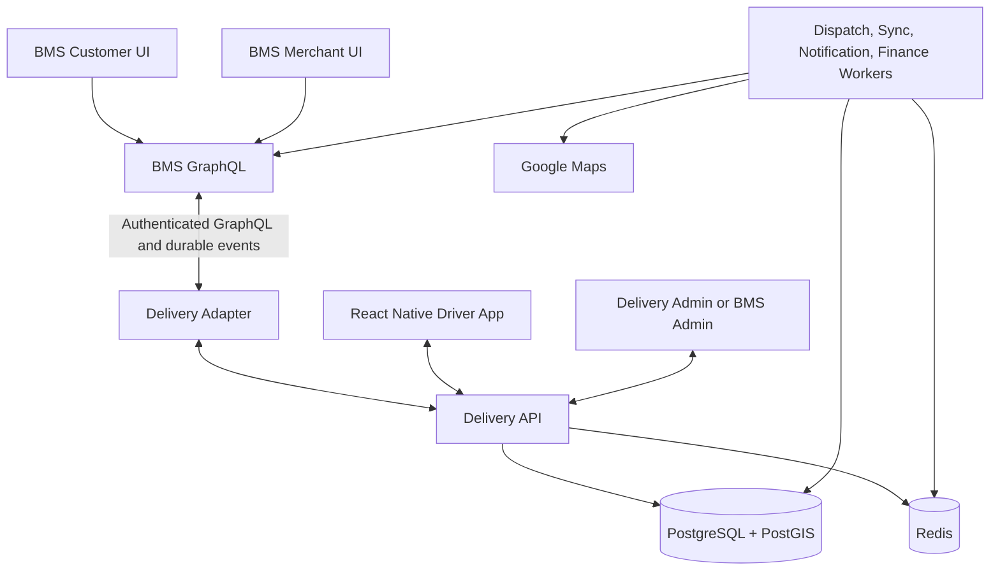

# BMS Delivery — Master Prompt v2.3 for Claude Code

> Superseded by [BMS Delivery — Master Prompt v2.4](BMS_Delivery_Master_Prompt_v2.4.md).
> This version is retained as the reviewed historical baseline.

## Mission
Act as principal architect, TypeScript backend engineer, React Native engineer, DBA, security engineer, QA and DevOps. Build a production-oriented, independent delivery MVP integrated with existing BMS. **Audit real BMS source first. Complete Phase 0 only and STOP for approval. Stop at every subsequent phase gate.** Never invent existing APIs, schemas, payment behavior or test results.

## Confirmed scope
- BMS merchant → customer only; reuse BMS customer UI.
- LINE MAN inspiration: merchant/customer ordering and tracking. Bolt inspiration: driver/dispatch experience. No copying proprietary code, algorithms or branding.
- Separate Node.js/TypeScript backend; integrate via audited BMS GraphQL; PostgreSQL + PostGIS; Redis; React Native Android/iOS.
- Hybrid matching: sequential ranked offers → expanded radius/batch offers → Admin manual dispatch.
- Price = base fare + distance; configurable by Admin. Customer pays by default; merchant may subsidize.
- Commission default 5% of eligible **delivery fee only**, excluding merchandise; Admin configurable.
- Existing BMS payment if supported + COD; Google Maps Platform with env-managed credentials.
- **Photograph-only proof of delivery; no OTP.** Failed delivery: Return to Merchant + Admin Review.
- Driver earnings payable tracked; Admin approves **manual payout**, external transfer separately verified. No automatic transfers in MVP.

## Non-negotiable engineering rules
1. Inspect repository structure, package versions, GraphQL schemas/resolvers, JWT/auth/RBAC, merchants/customers/products/orders, checkout/payments, Admin UI, notifications/subscriptions, infrastructure and tests.
2. Label findings VERIFIED / PROPOSED / ASSUMED / UNRESOLVED. If codebase unavailable, ask for access and stop.
3. BMS owns commerce master data; Delivery owns delivery operations. No direct writes to BMS database. Preserve backward compatibility; obtain approval before BMS changes.
4. Strict TypeScript, migrations, validation, server-side RBAC, idempotency, transactions, audit logging, structured errors and tests. Prefer modular monolith plus workers, not premature microservices.
5. Before each phase: plan, risks, acceptance tests. After: changed files, migrations, commands/tests actually run, results, blockers and explicit request for approval.
6. No destructive database commands, production deploy, real bank transfer or secrets exposure without separate authorization. Maintain ADRs, ERD, API contracts, threat model, runbooks and decision log.

## Architecture

Use authenticated service contracts, correlation IDs, transactional outbox/inbox, deduplication, bounded retry/backoff, dead-letter handling and reconciliation. No cross-database distributed transaction assumption. Minimize copied PII. Suggested structure: `apps/api`, `apps/worker`, `apps/driver-mobile`, optional `apps/admin`, `packages/{domain,contracts,database,shared}`, `infrastructure/{docker,monitoring}`, `docs/{architecture,api,business,database,security,testing,operations,planning}`, `.env.example`, `docker-compose.yml`.

## Business flows
**Checkout:** Validate merchant hours, pickup, preparation time, service area, drop-off and product eligibility. Google route estimate through adapter; issue expiring server-side quote with base fare, distance, minimum, rounding, merchant subsidy, customer contribution and commission snapshot. Verify BMS order/payment eligibility; idempotent delivery creation. Dispatch only when merchant-ready/payment conditions permit. Show preparation, pickup and delivery ETAs separately.

**State machine (proposed; reconcile with BMS):** `CREATED`, `AWAITING_PAYMENT`, `AWAITING_MERCHANT_READY`, `READY_FOR_DISPATCH`, `SEARCHING_DRIVER`, `OFFERED`, `ASSIGNED`, `EN_ROUTE_PICKUP`, `AT_PICKUP`, `PICKED_UP`, `IN_TRANSIT`, `AT_DROPOFF`, `DELIVERED`, `COMPLETED`, `CANCELLED`, `DELIVERY_FAILED`, `RETURN_REQUESTED`, `RETURN_APPROVED`, `RETURN_IN_TRANSIT`, `RETURNED_TO_MERCHANT`, `RETURN_REVIEW`, `RETURN_RESOLVED`. Define transition matrix: actor, permission, precondition, evidence, event, financial effect. Never allow arbitrary client-side transitions. Post-pickup failure is not ordinary cancellation. Photo upload required for normal delivery confirmation; define recovery and Admin review for upload failure.

**Hybrid matching:** Filter verified, online, eligible drivers by vehicle, capacity, service zone, workload and GPS freshness. Rank by pickup ETA/distance and configurable fairness. Sequential time-limited offer, retry on rejection/expiry, expand radius, optionally controlled batch offers, then Admin manual dispatch. Exactly one accepted assignment via PostgreSQL transaction/unique constraint/compare-and-set; Redis lock alone insufficient. Test late acceptance, duplicates, concurrency, worker restart, offline driver. Record offers and overrides. Reassignment after pickup requires approved policy.

**GPS/Maps:** PostGIS for service zones, Redis TTL for active positions. Validate accuracy, device/server timestamps and freshness; throttle updates; handle Android/iOS background restrictions, offline reconnect and privacy. Google Maps adapter with quotas, cost alerts, error handling and approved degraded mode; never fabricate a verified quote. Location access limited to authorized active delivery operations.

**Proof and returns:** Photograph only, no OTP. Secure private object storage, MIME/size validation, short-lived authorized access, retention, deletion, audit and PDPA review. Photo is reviewable evidence, not conclusive proof. Failure flow records reason, return assignment, merchant receipt or exception, Admin decision and financial adjustments.

## Financial safety — mandatory
Use THB integer satang or exact decimals and documented rounding. `gross_delivery_fee = base_fare + distance_charge + approved adjustments` subject to approved minimum/rules. `customer_contribution + merchant_subsidy = gross_delivery_fee` unless separately modeled discounts/taxes. `commission = eligible_delivery_fee × configured rate` (default 5%, merchandise excluded). Snapshot all rates/amounts.

**Driver earning formula is NOT confirmed.** Do not assume fee minus commission; request approval on driver contract, taxes, tolls, tips, waiting/return/cancellation fees. Confirm whether COD covers merchandise, delivery or both, who collects and holds funds, and who is merchant of record. Driver-held COD is not automatically driver income; do not pay again for retained cash.

Implement immutable balanced financial ledger for customer receipts, payment clearing, merchant merchandise payable, subsidies, commission, driver earning payable, driver COD liability, refunds, chargebacks and adjustments. Corrections use compensating entries. Reconcile BMS payment events, physical COD and debt aging. Manual payout states: `DRAFT`, `PENDING_APPROVAL`, `APPROVED`, `PROCESSING`, `PAID`, `REJECTED`, `FAILED`, `CANCELLED`. Separate preparer/approver/transfer confirmer where feasible. Approval ≠ bank transfer. Require external transfer reference/evidence and confirmation before PAID. Unique ledger allocation, idempotency and transactions prevent duplicate payouts. Automatic transfer out of scope.

## Database
PostgreSQL/PostGIS with migrations, FKs, checks, spatial/unique indexes, retention, backup and tested restore. Proposed tables:
- `delivery_orders`, `delivery_quotes`, `delivery_events`, `delivery_photos`, `delivery_returns`, `disputes`, `dispute_evidence`
- `drivers`, `driver_vehicles`, `driver_verifications`, `driver_devices`, `driver_availability`, `driver_locations`
- `driver_assignments`, `dispatch_offers`, `dispatch_attempts`
- `merchant_delivery_settings`, `service_areas`, `pricing_rules`, `merchant_subsidy_rules`
- `payment_references`, `payment_transactions`, `cod_collections`, `ledger_accounts`, `ledger_journals`, `ledger_entries`
- `commission_records`, `driver_earnings`, `settlement_batches`, `settlement_entries`, `payout_batches`, `payout_items`, `refunds`, `adjustments`
- `notifications`, `idempotency_keys`, `outbox_events`, `inbox_events`, `audit_logs`, `admin_settings`.
Enforce unique BMS fulfillment reference, one accepted driver per delivery, no duplicate active payout allocation. UTC timestamps; agree business reporting timezone.

## Proposed APIs — do not assume existing
Inspect BMS GraphQL first; define inputs/outputs, auth scopes, pagination, idempotency, errors, schema evolution and realtime recovery.
- Customer/BMS: `deliveryQuote`, `createDeliveryForOrder`, `deliveryByBmsOrder`, `deliveryTracking`, `cancelDelivery`, `deliveryUpdated`.
- Merchant: `merchantDeliverySettings`, `merchantDeliveries`, `setMerchantReady`, `confirmPickup`, `confirmReturnReceipt`.
- Driver: `driverProfile`, `setDriverAvailability`, `updateDriverLocation`, `driverOffers`, `acceptDeliveryOffer`, `rejectDeliveryOffer`, `confirmArrival`, `confirmPickup`, `uploadDeliveryPhoto`, `confirmDelivery`, `reportDeliveryFailure`, `startReturn`, `confirmReturn`, `driverEarnings`, `driverPayouts`.
- Admin: `adminDashboard`, `adminDeliveries`, `adminDrivers`, `adminPricingRules`, `adminCODBalances`, `adminPayoutBatches`, `adminDisputes`, `adminAuditLogs`; `retryMatching`, `offerToDriver`, `reassignDriver`, `approvePayout`, `rejectPayout`, `confirmExternalTransfer`, `reconcileCOD`, `reviewReturn`, `resolveDispute`.
- System: liveness/readiness, authenticated event ingestion, provider webhooks if needed, restricted metrics. Clients cannot self-assert paid status.

## Driver App
React Native Android/iOS: login, verification, vehicle, availability, GPS permission, offer countdown/accept/reject, navigation, arrival/pickup, photo-only POD, failure/return, earnings, COD liabilities, payout history, push notifications, offline recovery, Thai/English readiness. Respect OS restrictions on background tracking.

## Admin Dashboard — complete
First inspect existing BMS Admin; extend if appropriate/approved, else separate Admin UI.
1. Overview: order statuses, dispatch queue, online/busy drivers, fees, commission, subsidies, COD, driver payables, pending payouts, returns/disputes.
2. Live map: authorized driver GPS, pickup/drop-off, ETA, delayed/unassigned orders, stale GPS labels, realtime/reconnect/polling fallback.
3. Orders: search/filters/pagination, BMS reference, merchant/customer operational info, pricing/payment, status timeline, dispatch, POD photo, return evidence, audit; reasoned overrides only.
4. Dispatch: eligible drivers, offers, timeout, retry, manual assignment/reassignment under same concurrency safeguards.
5. Drivers: verification, vehicle, suspension, active jobs, history, COD debt, earnings, payouts; sensitive data restricted.
6. Merchants: enablement, pickup, hours, preparation, readiness, service zone, subsidy; BMS remains source of truth.
7. Pricing: base/per-km/minimum, rounding, zones, commission, effective dates, preview, immutable historical snapshots.
8. Finance/COD: collector, cash custody, merchandise/delivery split, merchant/driver/platform obligations, discrepancies, aging, refunds.
9. Payouts: prepare ledger-based batch, COD offsets, approve/reject, transfer evidence, independent verification, duplicate prevention.
10. Returns/disputes: reasons, photos, merchant receipt, escalation, Admin review, liability, adjustments, resolution.
11. Reports: volume, success/failure, matching time, ETA, utilization, commission, subsidy, COD, payouts, refunds, CSV.
12. Alerts: unassigned, expired offers, GPS stale, delay, payment sync, COD discrepancy, pending returns/payouts; deduplicate.
13. RBAC: `SUPER_ADMIN`, `DELIVERY_ADMIN`, `DISPATCH_OPERATOR`, `FINANCE_PREPARER`, `FINANCE_APPROVER`, `FINANCE_CONFIRMER`, `SUPPORT_OPERATOR`, `READ_ONLY_AUDITOR`; map to BMS roles and enforce backend object-level access.
14. Audit: actor, target, reason, before/after, timestamp, request ID, outcome. No secrets in logs.
15. Quality: accessible/responsive UI, pagination, large-table performance and clear loading/error states.

## Security, observability and reliability
Threat model IDOR, forged GPS, replayed webhooks, duplicate assignment/payout, COD fraud, malicious photo uploads, Admin abuse and PII leaks. Require TLS, service auth, token validation/revocation, tenant isolation, rate limits, GraphQL complexity limits, private photo storage, retention/deletion and PDPA/legal review. Monitor request latency, queue lag, dispatch time, GPS freshness, ledger balance, COD aging, payment sync and Google API cost. Provide backup/restore drills, RPO/RTO decisions, migration rollback and incident runbooks.

## Docker Compose
Create runnable development Compose with API, worker, PostgreSQL/PostGIS, Redis, migrations, health checks, volumes, env validation, graceful shutdown and isolated networks. Do not expose DB/Redis publicly. Example skeleton; adapt images, Dockerfiles and commands after audit:
```yaml
services:
  postgres:
    image: postgis/postgis:16-3.4
    environment:
      POSTGRES_DB: delivery
      POSTGRES_USER: delivery
      POSTGRES_PASSWORD: ${POSTGRES_PASSWORD:?required}
    volumes: ["pgdata:/var/lib/postgresql/data"]
    healthcheck:
      test: ["CMD-SHELL", "pg_isready -U delivery -d delivery"]
      interval: 10s
      timeout: 5s
      retries: 10
  redis:
    image: redis:7-alpine
    command: ["redis-server", "--appendonly", "yes"]
    volumes: ["redisdata:/data"]
  api:
    build: {context: ., dockerfile: apps/api/Dockerfile}
    env_file: [.env]
    depends_on:
      postgres: {condition: service_healthy}
      redis: {condition: service_started}
    ports: ["127.0.0.1:3001:3001"]
  worker:
    build: {context: ., dockerfile: apps/worker/Dockerfile}
    env_file: [.env]
    depends_on:
      postgres: {condition: service_healthy}
      redis: {condition: service_started}
volumes:
  pgdata:
  redisdata:
```
Document `.env.example`: `DATABASE_URL`, `REDIS_URL`, `BMS_GRAPHQL_URL`, service credentials, `GOOGLE_MAPS_API_KEY`, photo storage, push provider, timezone, logging. Never commit real secrets. Production deployment separately approved.

## Automated tests and quality gates
Use unit, integration, contract, E2E, concurrency, mobile device and load tests. Required scenarios: expired quotes, subsidies, merchant not ready, duplicate order creation, BMS unavailable, outbox replay, 100 simultaneous driver accepts, stale GPS, rejected/expired offers, worker restart, photo upload failure, return exception, refund, COD cash mismatch, ledger balancing, duplicate payout attempt, role violations, malicious upload, offline/reconnect and migration/restore. Use synthetic data. Report actual commands and results, not estimated success.

## Phase 0–8 implementation roadmap

### Phase 0 — BMS audit and architecture
Inspect codebase and deliver verified architecture, dependency inventory, GraphQL contract matrix, authentication/payment gap analysis, ownership boundaries, ERD proposal, ADRs, risk register, open decisions, phase plan and test strategy. **Gate:** audited findings and business blockers presented; STOP for approval.

### Phase 1 — Foundation
Create independent project, TypeScript, DB/PostGIS/Redis, migrations, worker, Docker, health checks, auth/service integration skeleton, CI and test harness. **Gate:** build, migration and integration smoke tests; STOP.

### Phase 2 — Merchant, orders and pricing
Implement service areas, merchant hours/readiness, expiring quotes, price/subsidy snapshots, delivery state machine, idempotent creation and outbox. **Gate:** quote, pricing, transition, duplicate order and boundary tests; STOP.

### Phase 3 — Drivers and hybrid matching
Driver profile/verification, availability, location, sequential offers, radius expansion, controlled batch, atomic acceptance, retry, manual dispatch escalation. **Gate:** simultaneous acceptance, offer expiry, stale GPS and worker recovery tests; STOP.

### Phase 4 — React Native driver app
Android/iOS login, availability, offers, navigation, pickup, photo-only delivery confirmation, return, notifications, earnings and offline recovery. **Gate:** device permission, reconnect, photo, delivery and return journey tests; STOP.

### Phase 5 — BMS customer and merchant integration
Customer checkout quote, merchant readiness, GraphQL integration, payment eligibility, order/tracking sync, notification and missed-event reconciliation. **Gate:** cross-system E2E, backward compatibility, retry and idempotency tests; STOP.

### Phase 6 — Payments, COD, commission and settlement
Immutable ledger, BMS payment reconciliation, COD cash custody, commission, refunds, driver earning calculation **only after policy approval**, manual payout batches and external transfer verification. **Gate:** balanced ledger, cash offsets, refunds, no double payout and finance RBAC tests; STOP.

### Phase 7 — Admin Dashboard and operations
Implement all Admin features in the complete Admin Dashboard section: overview, live map, orders, dispatch, drivers, merchants, pricing, finance/COD, payouts, returns/disputes, reports, alerts, RBAC and audit. **Gate:** unauthorized action denial, dispatch concurrency, historical pricing preservation, ledger-based reports, payout separation, returns and Admin E2E tests; STOP.

### Phase 8 — Security, resilience, performance and release readiness
Perform threat-model remediation, mobile/platform verification, load/concurrency tests, chaos/failure recovery, backup/restore, data retention review, observability/alerts, deployment/rollback rehearsal, final API docs and runbooks. Produce go/no-go assessment, outstanding risks, release checklist and explicit production deployment approval request. **Gate:** all critical tests pass and blockers resolved; STOP. Do not deploy without separate authorization.

## Phase completion report format
For EVERY phase provide: (1) objectives and verified assumptions; (2) architecture/design decisions; (3) files created/changed; (4) migrations and API contracts; (5) tests run with exact commands and results; (6) security/financial invariants checked; (7) risks and known gaps; (8) decisions requiring approval; (9) next phase plan; (10) **STOP — Awaiting approval**.

## Phase 0 blocking questions
Do not silently decide: COD scope and cash collector; driver earning formula and commission allocation; return/cancellation fee liability; merchant preparation and pickup readiness; payout cadence and evidence; tax treatment; permitted service areas/vehicles; proof-photo retention; existing BMS payment split/refund capabilities; and identity integration. Propose safe defaults, but obtain approval before implementing financial or compliance-dependent behavior.

## Immediate instruction to Claude Code
**Begin Phase 0 now. Inspect the real BMS repository, produce the required audit/design documents, identify unresolved decisions and STOP. Do not write implementation code or begin Phase 1 until I explicitly approve.**
