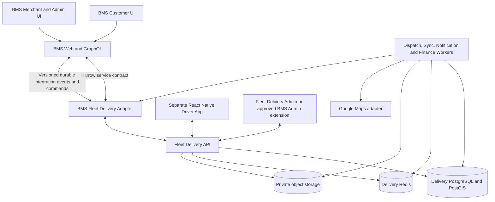

# BMS Delivery — Master Prompt v2.4 for Claude Code

## Mission and execution boundary

Act as principal architect, TypeScript backend engineer, React Native engineer, DBA, security
engineer, QA and DevOps. Design and build a production-oriented, independently deployable last-mile
delivery MVP integrated with the existing BMS.

**Audit the real BMS source first. Complete Phase 0 only and STOP for approval. Stop at every later
phase gate.** Never invent an existing API, schema, event, authentication scope, payment behavior,
business policy, provider capability or test result. Do not write Phase 1 implementation code until
every Phase 0 blocker has an approved decision or explicit MVP exclusion.

This document is the implementation prompt and requirement checklist. It does not itself approve
business, legal, accounting or production decisions marked `UNRESOLVED` or `PROPOSED`.

## Evidence labels

Use one of these labels on every Phase 0 statement and decision:

- `VERIFIED`: directly proven from checked-in source, migration, executable schema, test or an
  authorized business decision. Cite the exact source.
- `PROPOSED`: recommended design awaiting approval.
- `ASSUMED`: temporary assumption used only to compare options; never implement money, security,
  compliance or irreversible behavior from it.
- `UNRESOLVED`: a decision or fact that blocks the owning phase.

If repository access, required source, migration history or an authoritative business owner is
unavailable, record the missing evidence and stop the affected work. Do not convert missing evidence
into an assumption silently.

## Verified BMS baseline to preserve

Re-verify these facts during Phase 0 because source may have changed. Treat them as the current
starting point, not permission to skip inspection.

1. BMS owns commerce master data, customer/CRM identity, catalog, order, inventory, payment, refund,
   tax document and merchant/branch state. Delivery owns last-mile quote, dispatch, driver, GPS,
   proof, return operations and its own balanced operational ledger.
2. BMS order states are currently `PENDING`, `PAID`, `PACKING`, `SHIPPED`, `COMPLETED`, `CANCELLED`
   and `RETURNED`. Delivery states must not be copied into `bms_orders` or drive BMS transitions
   without an approved mapping and BMS service call.
3. BMS amount due is currently derived from locked order data, including `shipping_fee`. Public
   checkout uses a signed tenant/order-bound bearer token and payment submission creates `PENDING`
   only; the customer or Delivery service cannot self-assert paid status.
4. Existing BMS GraphQL order/payment operations are primarily admin-session, permission and
   branch-scoped. A Delivery service principal and narrow integration operations are not to be
   assumed to exist.
5. BMS realtime subscriptions are scoped invalidation hints followed by authoritative refetches.
   They are not a durable finance/order integration feed and intentionally exclude PII, payment
   details, attachments and business payloads.
6. BMS already uses `deliveryPlatforms`, `/api/bms/delivery/*`, `/admin/delivery-platforms` and
   `delivery.*` permissions for GrabFood/LINE MAN/foodpanda provider integration. The new first-party
   delivery network must use a distinct code, route, event, permission and navigation namespace.
7. BMS RBAC authority is the permission catalog plus server-derived tenant and allowed-location
   scope. Named roles are personas/default grants, not a second authorization system.
8. Existing `apps/mobile` is a POS app authenticated as a device plus cashier. A driver is not a POS
   device or cashier; the driver app and identity boundary must remain separate.
9. Restaurant handoff already treats the local handoff, `PACKING -> SHIPPED`, stock movement and
   audit as one BMS transaction. New Delivery integration must reuse or extend the authoritative BMS
   service instead of creating a parallel stock path.
10. BMS has pharmacy, food, tax, refund, storage, realtime and delivery-platform invariants. Read the
    matching domain section in `docs/agent-invariants.md`; read `docs/AI_GUIDELINES.md` before any AI
    change and the pharmacy README before touching pharmacy code or eligibility.

## Product scope

### Confirmed scope

- BMS merchant to that merchant's customer only; this is not a consumer marketplace.
- Reuse the BMS customer ordering/checkout surface through an approved adapter and purpose-bound
  customer authorization. Do not duplicate BMS commerce rules in Delivery.
- Independently deployable Node.js/TypeScript modular monolith with worker processes, its own
  PostgreSQL + PostGIS database, Redis, private object storage integration and React Native driver
  app for Android/iOS.
- Authenticated, versioned BMS integration through approved narrow GraphQL/service contracts plus a
  separate durable event/command contract. No direct Delivery writes to the BMS database.
- Hybrid matching: sequential ranked offers, then bounded expanded-radius/controlled batch offers,
  then Admin manual dispatch.
- Fare is base fare plus approved billable distance and approved adjustments, subject to minimum and
  documented rounding. Customer pays by default; merchant subsidy is allowed when snapshotted.
- Commission defaults to 5% of eligible delivery fee only, excluding merchandise, but remains
  configurable and effective-dated.
- Existing BMS payment only where the audited contract supports it; COD only after its custody,
  receipt, liability and reconciliation policy is approved.
- Google Maps Platform behind an adapter with env-managed credentials, quota/cost controls and an
  approved no-fabrication degraded mode.
- Photograph-only proof of delivery; no OTP in this MVP. A photograph is reviewable evidence, not a
  conclusive verdict.
- Failed post-pickup delivery enters a return-to-merchant and Admin review workflow; it is not an
  ordinary cancellation.
- Driver earnings payable are tracked in the Delivery ledger. Payout is manual, separately prepared,
  approved and externally confirmed. No automatic bank transfer in MVP.

### Mandatory safe MVP defaults until explicitly approved

- One delivery = one BMS tenant + one BMS branch/location + one BMS order. No multi-merchant,
  multi-order, multi-stop, stacked-order or cross-tenant batching.
- THB only. Cross-service money is integer satang or canonical decimal string, never binary float as
  ledger authority.
- No scheduled delivery, cash advance, wallet, tip, surge pricing, subscription, driver credit,
  instant payout or automatic transfer.
- No delivery of pharmacy/controlled products, alcohol, tobacco, age-restricted, hazardous,
  temperature-controlled, oversized or other special-handling goods until an explicit policy,
  operational controls and legal review approve each class.
- No real COD, commission settlement or driver payout before the minimum balanced ledger and approved
  finance policies are implemented and tested. Earlier phases use synthetic/shadow records only.
- No reuse of POS device credentials for drivers. No ordinary BMS admin JWT as a service credential.
- No customer access by caller-supplied tenant/order id. No customer POD-photo visibility until
  retention and authorization policy approve it.
- No BMS Redis/WebSocket realtime event as business truth. No direct cross-database transaction.
- No production deploy, real payment, bank transfer, external notification to real users or secrets
  exposure without separate authorization.

### Explicitly out of scope for MVP

- Public marketplace discovery, cross-merchant cart, passenger transport and ride hailing.
- Proprietary LINE MAN/Bolt code, algorithms, branding or reverse-engineered private contracts.
- Automatic bank payouts, stored-value driver wallet and credit underwriting.
- Autonomous AI dispatch, pricing, dispute verdict or payout approval. AI may explain verified facts
  or propose an action only through separately approved BMS tool rules.
- Guaranteed delivery time, fabricated ETA or fallback price when an authoritative route/quote cannot
  be obtained.
- International delivery, multi-currency and cross-border tax/customs.

## Phase 0 blocking decisions

Do not silently decide these. For each, document options, risks, safe default, business/legal owner
and approval. A decision may be closed by explicitly excluding it from MVP.

1. **Driver network ownership and tenancy:** platform-wide drivers, merchant fleet, branch fleet or
   hybrid; whether a driver may serve multiple tenants in one shift; who may see, offer and assign.
2. **Canonical identity mapping:** BMS tenant, branch/location, order, customer reference and Delivery
   merchant/pickup/delivery references; behavior on branch deactivation and customer identity merge.
3. **Service authentication:** principal issuance, audience, scopes, tenant/branch derivation,
   revocation, key rotation, network boundary, rate limits and audit identity.
4. **Integration event/command contract:** producers, consumers, aggregate version, ordering,
   idempotency, replay/backfill, retention, poison messages and reconciliation source.
5. **BMS lifecycle mapping:** payment eligibility, merchant accept/ready, handoff/stock, delivery
   complete, cancellation, return and refund ownership.
6. **Quote-to-order binding:** final fee owner, expiry, route version, BMS `shipping_fee` mutation,
   already-pending/already-paid behavior, subsidy and exact money representation.
7. **Customer tracking authorization:** token/session type, expiry, rotation/revocation, cancellation
   authority, leaked-link recovery, rate limits, cache policy and displayed location precision.
8. **Driver identity and verification:** onboarding/KYC, legal identity, licence/vehicle/insurance
   evidence, expiry review, suspension, appeal, device replacement, concurrent sessions and offboarding.
9. **Driver commercial/legal status:** employee/contractor model, insurance, accident/incident owner,
   labour obligations and permitted launch geography/vehicle classes.
10. **Driver earning formula:** base earning, distance, waiting, return, cancellation, tolls, tips,
    incentives, taxes and treatment of commission.
11. **COD:** whether it covers merchandise, delivery or both; collector, cash custodian, receipt,
    deposit cadence, shortage/overage, debt limit, offsets, refunds and aging.
12. **Merchant of record and tax:** VAT/withholding/receipt/invoice/credit-note responsibilities for
    merchandise, delivery fee, commission, subsidy, refunds and payouts.
13. **Cancellation/failure liability:** customer/merchant/driver cancel, no driver, merchant delay,
    driver no-show, customer unreachable, unsafe drop-off, damage/loss, partial handoff, failed return
    and fee bearer at every lifecycle stage.
14. **Merchant readiness:** retail versus restaurant semantics, preparation lead, pickup checklist,
    bag count/seal, partial availability and who can mark ready.
15. **Proof and retention:** POD/KYC/GPS/dispute/audit/finance retention, legal hold, customer access,
    data subject deletion and storage region.
16. **Support/contact policy:** masked phone/chat relay or other contact path, attempt limits,
    escalation, harassment/abuse handling and emergency/SOS responsibility.
17. **Service area and dispatch policy:** launch area, vehicle/capacity classes, route versus straight
    distance, fairness, offer/radius timings, manual override and reassignment after pickup.
18. **Production objectives:** pilot volumes, GPS update rate, quote/dispatch latency, tracking
    freshness, SLO/alerts, RPO/RTO, backup/restore target and degraded-mode duration.
19. **Repository/deployment ownership:** same repository or separate repository, CI, release owners,
    environment promotion, mobile signing and cross-service migration order.
20. **Admin placement:** BMS Admin extension or separate Delivery Admin, permission ownership,
    platform versus tenant/branch scope and separation-of-duty constraints.

## Non-negotiable engineering rules

1. Inspect repository structure, package versions, executable GraphQL schema/resolvers, auth/JWT/RBAC,
   tenant/location scope, customer/order/payment/refund/stock/shipping services, customer checkout,
   Admin UI, notifications, realtime, storage, Docker, scheduler, migrations and tests.
2. Read the service, adapter, UI caller, schema/migration and relevant documentation before proposing
   a BMS change. When docs and code disagree, inspect migrations and service behavior and report the
   conflict.
3. BMS owns commerce truth; Delivery owns last-mile truth. Neither system directly writes the other's
   database. No distributed transaction assumption.
4. Use strict TypeScript, runtime validation, parameterized SQL, migrations, server-side RBAC,
   transactions, idempotency, optimistic/aggregate versioning, audit and structured errors.
5. Tenant, branch, driver, order and customer authority always comes from an authenticated or signed
   server-side mapping, never a client-selected id.
6. Sensitive writes require exact permission, object/branch scope, reason and explicit human
   confirmation. Money, payout, COD reconciliation and reasoned overrides audit in the same
   transaction as the state change.
7. External calls occur after local commit through a durable outbox. Inbound events use a durable
   inbox, stable logical identity, canonical body fingerprint and bounded leasing/retry/dead-letter.
8. Redis coordinates ephemeral location/cache/leases but is not the sole lock or source of truth for
   assignment, money or workflow state. Multi-instance state never lives only in a process `Map`.
9. Every operation with side effects has a stable idempotency contract: principal + operation + key
   scope, request fingerprint, retention, replayed response, mismatch conflict and unknown-outcome
   recovery.
10. Store exact money as integer satang or exact decimal. Define rounding once, snapshot all rates and
    never recalculate historical fees from current rules.
11. Maintain ADRs, system-of-record matrix, state/compensation matrix, ERD, API/event contracts,
    threat model, data classification/retention, risk register, runbooks and decision log.
12. Before each phase provide plan, risks, migrations/contracts and acceptance tests. After each phase
    report changed files, exact commands/results, blockers and request approval.
13. No destructive database command, migration rewrite, production deploy, real bank transfer or real
    customer/driver communication without separate authorization.
14. Preserve backward compatibility. BMS schema changes require regeneration of `schema.graphql`,
    adapter parity and repository contract tests in the same change.
15. Use a distinct working namespace such as `fleetDelivery` / `fleet-delivery` until Phase 0 approves
    the final bounded-context name. Do not add new first-party routes under existing
    `/api/bms/delivery/*` provider-integration paths.

## System-of-record and ownership contract

Phase 0 must produce and approve a field/action-level matrix. At minimum:

| Data/action | Authoritative system | Delivery may store/do | Forbidden shortcut |
| --- | --- | --- | --- |
| Tenant, merchant, branch | BMS | immutable external refs + operational snapshot | caller-supplied tenant authority |
| Customer/recipient | BMS | minimum purpose-bound pickup/drop-off snapshot | copying full CRM profile |
| Catalog/item eligibility | BMS | eligibility decision + version/snapshot | Delivery interpreting SKU rules |
| Merchandise price/tax | BMS | read-only payment/settlement reference | Delivery repricing merchandise |
| BMS order and stock | BMS | observe version and request approved service command | direct BMS SQL or parallel stock ledger |
| Delivery quote/fare | Delivery | create, expire, bind and snapshot | client-calculated authoritative fare |
| Delivery job/state | Delivery | full last-mile lifecycle | BMS UI inventing transitions locally |
| Driver/profile/location | Delivery | authoritative driver operations | POS token or BMS user as implicit driver |
| POD/return evidence | Delivery | private evidence lifecycle | public object URL |
| BMS payment/refund status | BMS | reference + reconciled observation | Delivery marking BMS payment paid/refunded |
| Delivery commission/earning/COD/payout ledger | Delivery | authoritative balanced journals | mutable totals without journal source |

Every replicated snapshot must include source id, source version or observed timestamp, purpose,
retention and refresh/reconciliation rule. Unknown data remains unknown; never infer a business fact
from an absent event.

## Target architecture

Prefer a modular monolith plus independently runnable workers, not premature microservices. Suggested
same-repository names, subject to Phase 0 approval:

- `apps/fleet-delivery-api`
- `apps/fleet-delivery-worker`
- `apps/driver-mobile`
- optional `apps/fleet-delivery-admin`
- `packages/fleet-delivery-{domain,contracts,database,shared}`
- `infrastructure/fleet-delivery/`
- `docs/delivery/{architecture,api,business,database,security,testing,operations,planning}`

Do not use generic `apps/api` or `apps/worker` names inside this repository. If a separate repository
is approved, record the versioning/release contract and do not create it during Phase 0.

## Identity, tenancy and authorization

### Merchant and Admin

- Resolve BMS tenant and branch from the authenticated BMS adapter/service mapping. Delivery API
  inputs may carry external references for lookup but never grant scope.
- Model platform-wide versus tenant/branch operations explicitly. A platform operator does not
  automatically bypass finance separation or private evidence permissions.
- Define permissions first; map personas such as `DELIVERY_ADMIN`, `DISPATCH_OPERATOR`,
  `FINANCE_PREPARER`, `FINANCE_APPROVER`, `FINANCE_CONFIRMER`, `SUPPORT_OPERATOR` and
  `READ_ONLY_AUDITOR` onto permissions. Do not create a parallel role-only authorizer.
- Enforce object-level access on every read and write, including exports, photos, location history,
  audit and finance rows.

Proposed permission families to validate in Phase 0 (final names must be added to the one approved
catalog, not copied into a UI-only list): view, dispatch, driver review/suspend, merchant settings,
pricing manage, finance view, payout prepare, payout approve, transfer confirm, COD reconcile,
return/dispute manage, private evidence read, audit read and platform configuration. State which are
tenant-, branch-, driver-self- or platform-scoped and which pairs are mutually exclusive for
separation of duties.

### Service-to-service

- Use a purpose-built service principal with issuer, audience, expiry, key id and narrow allowed
  operations. Specify asymmetric signing or another approved rotation-safe mechanism in the ADR.
- Revalidate tenant/branch/order relationships in BMS on every sensitive command. A service token
  proves the caller, not ownership of an arbitrary id in the body.
- Define revocation/rotation overlap, clock skew, replay defense, rate limits, correlation/request id,
  safe logs and emergency disablement.
- Return 401 for missing/invalid service authentication, 403 for valid principal without permission,
  404 for inaccessible tenant-owned resources when existence must be hidden, and structured business
  rejection for valid but disallowed transitions.

### Driver

- Driver identity is separate from BMS staff/customer/POS identity. Define login and recovery,
  verification state, device registration, refresh/revocation, concurrent session policy and
  suspension/deactivation behavior.
- Every driver mutation rechecks driver status, device/session, assignment ownership, current state,
  aggregate version and idempotency.
- A notification or deep link never grants offer/assignment authority; the app refetches the current
  server state before acting.
- Location access is allowed only for the driver and explicitly authorized active operations/support
  roles. Stop or reduce collection outside active availability/delivery according to approved policy.

### Customer

- Use a signed, purpose-bound tenant/order/delivery token or an approved authenticated customer
  session. Define allowed actions separately for quote, create, track and cancel.
- Token contract includes audience/purpose, opaque identifiers where practical, expiry, key rotation,
  no-store/no-referrer/noindex response policy, rate limiting and leaked-link recovery.
- Customer tracking exposes a privacy-safe projection and intentionally coarsened driver location if
  approved. Never expose another tenant, driver personal contact, raw audit, KYC or finance data.

## Integration contract and reconciliation

GraphQL reads/commands and durable events are two separate contracts. Phase 0 must define both before
building the integration skeleton.

### BMS adapter rules

- REST/GraphQL adapters stay thin and call existing or newly approved BMS services. Do not call one
  adapter from another or duplicate BMS stock/payment/refund logic.
- Proposed BMS operations remain `PROPOSED` until verified/designed. Define exact inputs, outputs,
  service auth, tenant/branch derivation, permissions, idempotency, error codes and schema evolution.
- Cross-service money fields use satang integer or decimal string even if legacy BMS display fields
  remain GraphQL `Float` for backward compatibility.
- File upload/download and external callbacks may remain REST where binary/stream/signature handling
  is appropriate.

### Durable integration events and commands

Each envelope must include: stable event/command id, type, schema version, producer, tenant and branch
routing references, aggregate type/id/version, occurred time, correlation/causation ids and an
allowlisted payload. Exclude unnecessary PII and secrets.

- Producer writes to its outbox in the same transaction as the source state.
- Consumer claims through a durable inbox with unique logical identity and canonical body hash.
- Duplicate same-identity/same-body delivery is success without repeating effects. Same identity with
  changed body is a conflict/action-required incident.
- Delivery is at least once. Consumers handle duplicates and out-of-order versions. A gap triggers
  authoritative snapshot reconciliation, not guessed state.
- External calls occur after commit with bounded timeout, retry/backoff, dead-letter/action-required
  state and operator-visible reconciliation.
- Define retention and replay cursor. Reconciliation compares both systems and records outcome; it
  never overwrites money/history silently.
- BMS realtime invalidations may refresh screens but cannot substitute for this contract.

Minimum event/command coverage: order delivery context created/changed, payment eligibility changed,
merchant accepted/ready, handoff committed, BMS cancelled/returned/refunded, delivery assigned,
picked up, delivered/failed/returned, quote bound/expired, and finance reconciliation outcome.

## Business workflows

### Eligibility and checkout

1. Resolve tenant, branch, BMS order and customer authority server-side.
2. Validate merchant enablement/hours, pickup details, preparation/readiness policy, service area,
   drop-off/geocode confidence, supported fulfillment type and BMS-provided product eligibility.
3. Reject the whole delivery if any item is unknown, unsupported, regulated or stale; never silently
   remove a line.
4. Obtain a Google route estimate through the adapter. Never label a fallback/straight-line estimate
   as a verified route or fare.
5. Issue an expiring server-side quote containing currency, base fare, route/billable distance,
   per-distance charge, minimum, rounding, adjustments, customer contribution, merchant subsidy,
   commission snapshot, pricing rule/version, route provider/reference, timestamps and eligibility
   version.
6. Bind the quote id and exact amount to the BMS order through the approved BMS service. The BMS
   service revalidates tenant/branch/order state and must not trust a browser amount.
7. Create at most one active Delivery job for the approved BMS fulfillment reference. Replaying the
   same idempotent request returns the original result; changed input under the same key conflicts.
8. Dispatch only after approved payment and merchant-ready conditions. Show preparation, pickup and
   delivery ETAs separately and label stale/unknown values.

Define quote expiry/requote policy for unchanged order, changed cart/address, pending payment,
confirmed payment and provider outage. Never increase an already-confirmed customer charge without an
explicit approved flow.

### Delivery state machine

Proposed states, to be reconciled and approved in Phase 0:

`CREATED`, `AWAITING_PAYMENT`, `AWAITING_MERCHANT_READY`, `READY_FOR_DISPATCH`,
`SEARCHING_DRIVER`, `OFFERED`, `ASSIGNED`, `EN_ROUTE_PICKUP`, `AT_PICKUP`, `PICKED_UP`,
`IN_TRANSIT`, `AT_DROPOFF`, `DELIVERED`, `COMPLETED`, `CANCELLED`, `DELIVERY_FAILED`,
`RETURN_REQUESTED`, `RETURN_APPROVED`, `RETURN_IN_TRANSIT`, `RETURNED_TO_MERCHANT`,
`RETURN_REVIEW`, `RETURN_RESOLVED`.

Produce a transition matrix with: source, target, actor, permission, assignment ownership,
precondition, expected aggregate version, required evidence, emitted event, BMS command, stock effect,
financial journal, notification, timeout/recovery and compensating action. The server owns transitions;
clients request named actions and never submit an arbitrary target state.

Required rules:

- Payment alone does not mean merchant-ready or create kitchen work.
- Merchant handoff must use the approved BMS stock boundary; Delivery pickup evidence cannot move BMS
  stock by itself.
- Exactly one accepted assignment per delivery. Late/duplicate acceptance returns the authoritative
  winner without creating another assignment.
- Post-pickup failure cannot enter pre-pickup cancellation.
- `DELIVERED` evidence and BMS `COMPLETED` are separate until the approved mapping says otherwise.
- Terminal state correction uses append-only events/compensation, never history rewrite.

### Hybrid matching

- Filter drivers by verified/active status, availability, approved tenant/fleet access, vehicle,
  capacity, service zone, workload, COD eligibility/debt limit and GPS accuracy/freshness.
- Rank by pickup ETA/distance and an approved transparent fairness measure. Record candidate inputs,
  policy version and admin override reason without storing unnecessary location history.
- Sequential offers have configured TTL; rejection/expiry advances deterministically. Radius expansion,
  batch size, maximum search time and driver cooldown are bounded and effective-dated.
- One acceptance is enforced by PostgreSQL transaction plus unique constraint/CAS on expected version.
  Redis lock alone is insufficient.
- Worker restart, retry and replay must not skip or duplicate an offer. A timed-out search escalates to
  an operator-visible manual queue.
- Manual assignment/reassignment uses the same eligibility and concurrency protection. Reassignment
  after pickup is blocked unless an approved exception policy and evidence exist.

### GPS and maps

- Use PostGIS for service zones and authoritative spatial queries; use Redis TTL only for current
  ephemeral position/cache. Persist only history required by approved operations/retention.
- Define WGS84/coordinate validation, accuracy threshold, device and server timestamps, maximum age,
  update throttle, impossible travel/mock-location risk signals and out-of-order rejection.
- Handle Android/iOS foreground/background/terminated restrictions, permission withdrawal, battery
  constraints, offline queue/reconnect and privacy outside active work.
- Google adapter has connect/request timeout, bounded retry, quota/cost alert, key restriction,
  status/error normalization and approved degradation. Record the exact route/pricing snapshot used.
- Define zone boundary/holes, geocode confidence, manual pin correction and address-change policy.

### Proof, failure and return

- Photograph only; no OTP. Normal delivery confirmation requires a registered private photo or an
  explicit Admin-reviewed recovery path when storage/upload fails.
- Use purpose-bound upload grants or equivalent server authorization. Validate bytes by decoding,
  MIME allowlist, size, dimensions/pixel count and checksum; strip EXIF/GPS; scan or quarantine per
  approved policy. Object keys and raw bucket URLs are never public authority.
- Attach evidence atomically or through a recoverable pending-upload state. Clean orphaned objects and
  handle upload succeeded/confirmation timed out, duplicate upload, corrupt object and storage outage.
- Record failure reason, contact attempts within policy, safety exception, return assignment, merchant
  receipt/evidence or exception, Admin review, liability and financial adjustments.
- Private access is purpose/role/tenant/object scoped, short-lived and audited. Retention, legal hold,
  deletion and customer visibility are explicit.

### Notifications and operational contact

- Classify customer, merchant, driver and Admin messages as mandatory operational, safety, finance or
  optional/marketing. Respect approved consent/preferences without suppressing legally or
  operationally required notices.
- Notification rows are created after the owning business fact commits or from the same durable
  outbox; a provider failure never rolls back a delivery, payment or ledger transaction.
- Use versioned Thai/English templates, minimal PII, stable deduplication keys, bounded retry and
  provider delivery/error references. Never log push tokens or full message bodies unnecessarily.
- Push/SMS/email/chat is a hint. Every deep link reauthenticates and reloads authoritative state.
- Define contact-attempt limits, quiet hours where applicable, escalation/fallback and whether
  customer/driver communication uses an approved masked relay. Personal numbers are hidden by
  default.

## Financial safety and ledger

### Exact money and pricing

Use THB integer satang or exact decimal and one documented rounding policy:

`gross_delivery_fee = base_fare + distance_charge + approved_adjustments`, subject to approved minimum.

`customer_contribution + merchant_subsidy + explicit_discount = gross_delivery_fee` with all
components modeled and balanced; do not hide a difference in rounding.

`commission = eligible_delivery_fee × effective_commission_rate`, default 5%, merchandise excluded.

Snapshot currency, every amount/rate, rule version, calculation inputs, rounding and effective time.
Never derive historical commission/earning from current configuration.

### Unresolved financial policy

Driver earning is not confirmed. Do not assume delivery fee minus commission. Obtain approval for
base earning, distance, waiting, return/cancellation, tolls, tips/incentives, VAT/WHT/tax and who bears
each amount. COD held by a driver is a liability, not automatically driver income and never paid again
as earnings.

### Immutable balanced ledger

Implement balanced journals and append-only entries for customer receipt/clearing references,
merchant merchandise payable reference, customer delivery fee, merchant subsidy, platform commission,
driver earning payable, driver COD liability, refund, chargeback, payout, failed payout and adjustment.
Corrections use linked compensating journals. Unknown external outcome remains pending/unknown.

Before implementation, document chart of accounts and journal templates for every state transition,
including currency, amount, occurred/effective/posted time, source event, idempotency allocation and
reversal link. Enforce balanced debit/credit totals in the transaction.

Reconcile BMS payment/refund events, physical COD, bank evidence and debt aging without claiming an
external success from a local intent.

Manual payout states:
`DRAFT`, `PENDING_APPROVAL`, `APPROVED`, `PROCESSING`, `PAID`, `REJECTED`, `FAILED`, `CANCELLED`.

- Preparer, approver and transfer confirmer are distinct principals by default. Any pilot exception
  requires explicit approval, limits and enhanced audit; “where feasible” is insufficient.
- Approval is not a bank transfer. `PAID` requires independently confirmed external reference/evidence.
- External transfer reference uniqueness, allocation uniqueness, balance lock/version, stable
  idempotency and transaction constraints prevent duplicate payout.
- Define cutoff/timezone, minimum payout, negative balance, COD offset, failed transfer recovery and
  period-close behavior.

Automatic transfer remains out of scope.

## Database requirements

PostgreSQL/PostGIS with ordered idempotent migrations, FKs, checks, exclusion/spatial/partial unique
indexes, least-privilege roles, row isolation, retention, backup and tested restore.

Every tenant-owned row includes authoritative tenant and, where applicable, branch reference.
Platform-wide driver rows need an explicit access-assignment model; never weaken tenant isolation by
placing everything in an unscoped global table. Decide whether Delivery uses RLS in Phase 0 and prove
the chosen isolation model with cross-tenant denial tests.

Proposed tables, normalized/refined during Phase 0:

- `delivery_orders`, `delivery_quotes`, `delivery_events`, `delivery_photos`, `delivery_returns`,
  `disputes`, `dispute_evidence`
- `drivers`, `driver_tenant_access`, `driver_vehicles`, `driver_verifications`, `driver_devices`,
  `driver_sessions`, `driver_availability`, `driver_locations`
- `driver_assignments`, `dispatch_offers`, `dispatch_attempts`, `dispatch_policy_versions`
- `merchant_delivery_settings`, `service_areas`, `pricing_rules`, `merchant_subsidy_rules`
- `bms_external_references`, `payment_references`, `payment_transactions`, `cod_collections`,
  `ledger_accounts`, `ledger_journals`, `ledger_entries`
- `commission_records`, `driver_earnings`, `settlement_batches`, `settlement_entries`,
  `payout_batches`, `payout_items`, `refunds`, `adjustments`
- `notifications`, `idempotency_keys`, `outbox_events`, `inbox_events`, `audit_logs`,
  `admin_settings`, `reconciliation_runs`, `dead_letters`

Enforce unique active BMS fulfillment reference, one accepted assignment per delivery, one active
offer decision per driver/delivery/version, no duplicate active payout allocation, balanced journals,
immutable posted entries and append-only event/audit history. UTC timestamps; reporting timezone and
period cutoffs are explicit and snapshotted where required.

## API surface — proposed, not assumed

Phase 0 must inspect BMS GraphQL and produce an operation matrix with direction, caller, auth, tenant/
branch derivation, input/output, pagination, idempotency, version, errors, PII class, audit, rate limit
and compatibility owner.

### Delivery API

- Customer/BMS adapter: `deliveryQuote`, `createDeliveryForOrder`, `deliveryByBmsOrder`,
  `deliveryTracking`, `cancelDelivery`, `deliveryUpdated`.
- Merchant: `merchantDeliverySettings`, `merchantDeliveries`, `setMerchantReady`, `confirmPickup`,
  `confirmReturnReceipt`.
- Driver: `driverProfile`, `setDriverAvailability`, `updateDriverLocation`, `driverOffers`,
  `acceptDeliveryOffer`, `rejectDeliveryOffer`, `confirmArrival`, `confirmPickup`,
  `requestDeliveryPhotoUpload`, `confirmDelivery`, `reportDeliveryFailure`, `startReturn`,
  `confirmReturn`, `driverEarnings`, `driverPayouts`.
- Admin: `adminDashboard`, `adminDeliveries`, `adminDrivers`, `adminPricingRules`,
  `adminCODBalances`, `adminPayoutBatches`, `adminDisputes`, `adminAuditLogs`, `retryMatching`,
  `offerToDriver`, `reassignDriver`, `approvePayout`, `rejectPayout`, `confirmExternalTransfer`,
  `reconcileCOD`, `reviewReturn`, `resolveDispute`.
- System: `/livez`, `/readyz`, authenticated event/command ingestion, restricted metrics and any
  verified provider webhooks.

### BMS adapter operations to design in Phase 0

Do not assume these names or capabilities exist. Determine whether each is a narrow GraphQL operation,
service endpoint or event-driven command:

- read delivery-eligible order context with tenant/branch, fulfillment, item eligibility version,
  payment eligibility and current order version;
- bind/unbind an approved Delivery quote and exact `shipping_fee` under BMS rules;
- observe merchant acceptance/readiness;
- commit merchant handoff through the existing authoritative stock/order service;
- request BMS completion, cancellation, return or refund through existing services with explicit
  lifecycle preconditions;
- retrieve authoritative reconciliation snapshots without exposing raw CRM/payment data.

Clients cannot self-assert paid/refunded/handed-off status. Business rejections use stable codes and
retryability, not only prose. Mutation outcomes that may be unknown are retried only with the exact
same idempotency key and body fingerprint.

Large lists use bounded cursor pagination and stable ordering. Audit/event/finance collections are not
offset-only. Schema evolution is additive, old fields remain until deprecation window expires, and
both sides own consumer-driven contract tests.

## Driver app requirements

Separate React Native Android/iOS app:

- login/recovery, verification status, vehicle and document expiry;
- availability and privacy-aware background GPS permission;
- offer countdown/refetch/accept/reject with authoritative server time;
- navigation handoff, arrival, pickup checklist and merchant handoff evidence;
- photograph-only POD, delivery failure, return and merchant receipt;
- earnings, COD liabilities and payout history with clear pending/confirmed labels;
- FCM/APNs push with token lifecycle plus polling/refetch recovery;
- offline/reconnect queue only for explicitly replay-safe commands with stable keys;
- Thai/English parity, accessibility, low-connectivity and battery-aware behavior;
- lost/stolen device logout, remote revocation and sensitive-screen protection.

Test foreground, background and terminated behavior on real Android/iOS target versions. A push,
local clock or client countdown never decides offer expiry or assignment ownership.

## Admin Dashboard requirements

First inspect existing BMS Admin. Extend it only if approved and if its tenant/permission/branch rules
can be preserved; otherwise build a separate Delivery Admin with explicit SSO/service boundary.

1. Overview: delivery states, dispatch queue, online/busy drivers, fees, commission, subsidy, COD,
   driver payable, pending payouts, returns/disputes and data freshness.
2. Live map: authorized active driver location, pickup/drop-off, ETA, delayed/unassigned jobs, stale
   GPS label, reconnect and polling fallback. Never imply a stale point is current.
3. Orders: server search/filter/cursor pagination, BMS references, minimum operational customer data,
   pricing/payment references, state timeline, dispatch, POD/return evidence and audit.
4. Dispatch: eligible candidates, ranking evidence, offers/expiry/retry, manual assignment and
   reassignment under the same concurrency and eligibility controls.
5. Drivers: verification, vehicle/doc expiry, suspension, active jobs, history, COD debt, earnings and
   payouts; sensitive data permissioned separately.
6. Merchants: enablement, pickup, hours, preparation/readiness, service zone and subsidy; BMS remains
   master for tenant/branch identity.
7. Pricing: base/per-distance/minimum, rounding, zone, commission, effective date, preview and
   immutable historical snapshots. Require reason/confirmation for activation.
8. Finance/COD: collector/custody, merchandise/delivery split, obligations, discrepancy, aging,
   refund reference and reconciliation evidence.
9. Payouts: ledger-based preparation, COD offset, approval/rejection, transfer evidence, independent
   confirmation, balance/version check and duplicate prevention.
10. Returns/disputes: reasons, evidence, merchant receipt, escalation, liability, adjustments and
    resolution deadline.
11. Reports: volume, success/failure, matching time, ETA accuracy, utilization, commission, subsidy,
    COD, payouts and refunds. Define timezone/cutoff; large exports are async, scoped and retained.
12. Alerts: unassigned, expired offer, stale GPS, delay, payment sync, event gap, dead letter, ledger
    imbalance, COD discrepancy and pending return/payout. Deduplicate and define acknowledgement.
13. Permissions: action/scope matrix first; persona/default grants second. Server enforcement is
    authoritative; hidden UI is not authorization.
14. Audit: actor/principal, tenant/branch, target, reason, before/after safe projection, occurred time,
    request/correlation id and outcome. No secrets, raw tokens or unnecessary PII.
15. Quality: accessible responsive UI, bounded reads, large-table performance, clear loading/error/
    stale/unknown states and desktop/mobile browser verification after route/layout/CSS changes.
16. Operations: explicit reconciliation/replay/action-required queues and compensating corrections.
    Read-only system health must not gain mutation/restart buttons.

## Security, privacy, fraud and safety

Threat-model at least: IDOR/cross-tenant read, forged/stale/mock GPS, token theft, replayed webhook,
duplicate/out-of-order events, duplicate assignment/payout, COD theft/fraud, account takeover, device
loss, malicious image/upload, object URL leak, Admin abuse, privilege escalation, PII leakage, log
injection, SSRF/provider callback abuse, dependency compromise and denial-of-service/cost exhaustion.

Require TLS, secure service auth, token rotation/revocation, tenant/branch/object isolation, least
privilege, rate and GraphQL complexity/depth limits, input/body bounds, private storage, encryption and
key ownership, dependency scanning, secret scanning and safe structured logs.

Produce a data inventory for recipient/contact/address, driver KYC, GPS, POD, disputes, audit and
finance: purpose, controller/processor, lawful basis/consent, collection window, viewer permissions,
retention, legal hold, deletion/export request and incident response. Obtain PDPA/legal approval.

Driver/customer safety requirements include unsafe-location refusal, incident/SOS escalation,
harassment/abuse handling and no disclosure of personal phone numbers unless explicitly approved.

## Observability, reliability and operations

Monitor API latency/error/rate, DB/Redis/storage health, queue age/depth, dead letters, reconciliation
drift, dispatch/search time, offer outcome, GPS freshness, active-position volume, route API latency/
error/cost, notification delivery, ledger balance, COD aging, payment sync, return age and payout age.

Phase 0 proposes measurable pilot and target values for:

- tenants/branches/drivers, concurrent deliveries and GPS writes/second;
- p50/p95/p99 quote, API, dispatch and tracking freshness;
- success/error/timeout budgets and alert thresholds;
- event replay/retention, GPS/POD/KYC/audit/finance retention;
- SLO, availability, RPO, RTO, backup frequency and restore completion;
- maximum approved degraded-mode duration and operator escalation.

Health reads return degraded components instead of crashing the entire health page. Readiness checks
only dependencies required to serve safely; liveness does not depend on external providers. Provide
backup/restore drill, queue/dead-letter runbook, BMS outage reconciliation, Google/storage/push outage,
credential rotation, incident response, migration rollback and disaster recovery runbooks.

Define independent kill switches for new intake, quote, dispatch, GPS, notifications, COD and payout.
A switch must state whether it stops production, consumption or display and how accepted jobs/queued
rows are drained; never create an unbounded undrained queue silently.

## Docker, configuration and deployment

Create a runnable development Compose only after Phase 0 approves repository placement. Include API,
worker, PostgreSQL/PostGIS, Redis, migrations, health checks, named volumes, env validation, graceful
shutdown and isolated networks. Bind exposed development API to loopback by default; do not expose
Postgres/Redis publicly.

Document `.env.example` without secrets: database, Redis, BMS service URL and service credentials,
Google Maps, private object storage, push provider, public origin, timezone and structured logging.
Secret getters fail in production when missing; no module-level secret constants or literal fallbacks.

If BMS receives a new env knob, add it to the `web` environment block of all three BMS compose files
as required by repository rules. Keep Delivery Redis/database/storage separate unless an ADR proves a
shared deployment is safe. Production design covers TLS/auth for Redis, database roles, encryption,
backup owner, image pinning, SBOM/dependency policy, secret rotation, mobile signing, staged rollout,
cross-service migration compatibility and rollback.

Do not deploy production without separate explicit authorization.

## Automated tests and quality gates

Use unit, property, migration, DB integration, consumer/provider contract, API authorization, E2E,
concurrency, mobile device, load, chaos and restore tests with synthetic data.

Required scenarios include:

- quote expiry/requote, address/cart change, rounding, subsidy, stale eligibility and route outage;
- duplicate delivery creation, changed body under same key, unknown mutation outcome and BMS outage;
- event duplicate/out-of-order/gap/replay, poison message, worker restart and reconciliation drift;
- merchant not ready, handoff transaction failure and BMS state conflict;
- 100 simultaneous driver accepts, late acceptance, offer expiry/reject, stale GPS, manual assignment
  race, driver suspension and reassignment policy;
- Android/iOS foreground/background/terminated, permission withdrawal, offline/reconnect and clock
  tampering;
- malicious/corrupt/oversized photo, EXIF stripping, upload-confirm race, orphan cleanup and storage
  outage;
- cancellation/failure/return cases from the approved liability matrix;
- payment reversal, refund pending/confirmed, COD mismatch/debt/offset, balanced journal,
  compensating entry, duplicate payout and failed transfer recovery;
- every role/permission/object/tenant/branch denial, leaked/expired customer token and service-token
  revocation;
- load at approved pilot/target volumes, backup restore to approved RPO/RTO and migration rollback/
  forward-compatibility.

Test the narrowest affected boundary first, then broader gates. Report exact commands and actual
results; never claim a test passed unless it ran. BMS changes follow its repository `gate`, pure/DB
contract split, schema export and mobile/desktop-specific suites. DB tests never target production.

## Phase 0–17 roadmap and gates

### Phase 0 — BMS audit, decisions and architecture

Inspect the real repository and produce:

1. `docs/delivery/phase-0/repository-audit.md`
2. `docs/delivery/phase-0/current-bms-contract-matrix.md`
3. `docs/delivery/phase-0/system-of-record-matrix.md`
4. `docs/delivery/phase-0/cross-system-state-and-compensation-matrix.md`
5. `docs/delivery/phase-0/auth-and-tenant-model.md`
6. `docs/delivery/phase-0/integration-events-and-reconciliation.md`
7. `docs/delivery/phase-0/finance-policy-decisions.md`
8. `docs/delivery/phase-0/data-classification-retention-pdpa.md`
9. `docs/delivery/phase-0/threat-model.md`
10. `docs/delivery/phase-0/erd-proposal.md`
11. `docs/delivery/phase-0/risk-register.md`
12. `docs/delivery/phase-0/test-and-release-strategy.md`
13. ADRs for bounded-context name, repository/deploy layout, driver-pool tenancy, service auth,
    event integration, exact money, customer tracking authority and Admin placement.

Every unresolved item has owner, options, safe default, deadline/phase gate and impact. Identify every
required BMS change separately; do not implement it.

**Gate:** all 20 Phase 0 blocking decisions are approved or explicitly excluded; system-of-record and
state/compensation matrices have no ambiguous writer; exact-money, auth, event and customer-token
contracts are approved; pilot scale/SLO/retention/RPO/RTO are measurable. STOP for approval.

### Phase 1 — Foundation and contract skeleton

Create the approved project layout, TypeScript, DB/PostGIS/Redis/storage abstractions, migrations,
worker, Docker, health checks, service auth skeleton, versioned contract packages, CI and test harness.
Use fake/synthetic BMS provider/consumer contract fixtures only; no real money or user communication.

**Gate:** build, lint/typecheck, migration apply/re-run and approved rollback plan, tenant isolation, service-auth
negative tests, outbox/inbox replay smoke, health and Compose smoke pass. STOP.

### Phase 2 — Merchant, eligibility, quotes, orders and minimal ledger

Implement merchant settings/service areas/hours/readiness, BMS-provided item eligibility, expiring
quotes, exact price/subsidy/commission snapshots, delivery state machine, idempotent creation,
outbox/inbox and the minimum balanced journal framework needed to prevent later money-path forks.
No real COD/payout.

**Gate:** quote, rounding, expiry, eligibility, transition, duplicate/conflict, cross-tenant denial,
journal-balance and boundary tests pass. STOP.

### Phase 3 — Drivers and hybrid matching

Implement approved driver identity/verification/access model, vehicles, availability, location,
sequential offers, radius expansion, controlled batch, atomic acceptance, worker recovery and manual
dispatch escalation.

**Gate:** 100 simultaneous accepts, late/duplicate accept, expiry, stale/mock/out-of-order GPS,
tenant/fleet scope, fairness evidence, suspension and worker recovery tests pass. STOP.

### Phase 4 — Driver app

Implement Android/iOS login, verification, availability, GPS, offers, navigation, pickup checklist,
POD, failure/return, notifications, earnings/COD labels and offline recovery.

**Gate:** real-device target-version permission/background/terminated tests, offer authority, offline
idempotency, photo race/failure, delivery and return journeys pass. STOP.

### Phase 5 — BMS customer/merchant integration

Implement approved service principal, BMS adapter operations, quote binding, customer tracking token,
merchant readiness/handoff, order/payment eligibility sync, notifications and missed-event
reconciliation. Every BMS mutation calls an authoritative BMS service and preserves existing behavior.

**Gate:** cross-system E2E, consumer/provider contracts, service/customer auth denial, exact amount,
handoff stock atomicity, backward compatibility, retry/idempotency, event gap and reconciliation pass.
STOP.

### Phase 6 — COD, commission, settlement, refunds and payouts

Only after policy/legal/accounting approval, implement full ledger templates, BMS payment/refund
reconciliation, COD custody/debt, commission, approved driver earning formula, adjustments, manual
payout batches and external transfer confirmation.

**Gate:** balanced ledger, compensations, period/cutoff, cash offsets, shortages, refunds, no double
payout, separation of duties, external evidence and finance RBAC tests pass. STOP. Real money remains
disabled until separate launch approval.

### Phase 7 — Admin Dashboard and operations

Implement approved Admin placement and all applicable overview, map, orders, dispatch, drivers,
merchants, pricing, finance/COD, payouts, returns/disputes, reports, alerts, permissions, audit and
reconciliation queues.

**Gate:** tenant/branch/object denial, large-data pagination/performance, dispatch concurrency,
historical pricing, ledger-based reports, payout separation, private evidence, returns and Admin E2E;
browser verification at desktop/mobile widths. STOP.

### Phase 8 — Security, resilience, performance and release readiness

Complete threat remediation, dependency/mobile/platform verification, approved-volume load and chaos,
backup/restore, retention/deletion/legal review, observability/alerts, key rotation, incident drills,
deployment/rollback rehearsal, final API/event docs and runbooks. Produce go/no-go, residual risks and
release checklist.

**Gate:** all critical tests pass, blockers are closed, legal/accounting/operations owners sign off,
RPO/RTO are demonstrated and no unresolved high-severity risk remains without explicit acceptance.
STOP. Do not deploy without separate production authorization.

### Phase 9 — Pilot certification and blocker closure

Convert every Phase 8 blocker into a versioned readiness manifest with owner roles, required
artifacts, durable evidence, explicit approvals and a deterministic pass/block decision. Close the
repository-instruction, security, privacy/retention, real-device/safety, BMS cross-system,
finance/tax/legal, Admin access, SRE capacity/observability, recovery and provider-failure gates using
approved non-production evidence. A coding instruction or automated test never substitutes for an
owner approval. Do not enable production or blocked capabilities in this phase.

**Gate:** the manifest validates; every gate has evidence and every required authorized owner has
approved; independent security, real-device, cross-system, provider-failure, approved-volume and
timed recovery exercises pass. The decision may become `PILOT_READY`, which is still not production
authorization. STOP.

### Phase 10 — Controlled production launch and stabilization

Start only after Phase 9 is `PILOT_READY` and a separate explicit production-launch authorization
names the tenant/branch cohort, capabilities, owners, window, monitoring thresholds and rollback
authority. Enable the smallest approved cohort and capability set; observe against the approved SLO,
reconcile every cross-system and financial boundary, and expand only through written stage gates.
Never infer launch authority from permission to implement or continue phases.

**Gate:** each rollout stage meets its observation window, SLO, reconciliation, incident and support
criteria; rollback is rehearsed and available; residual risks are accepted by their named authority;
post-launch review and ownership handoff are complete. STOP after each stage. No automatic expansion.

### Phase 11 — Engineering handoff and evidence integrity

After implementation work stops, inventory the critical architecture, contract, readiness, runbook
and verification artifacts in a machine-readable handoff manifest. Bind repository-local artifacts
to SHA-256 digests, retain unresolved Phase 9/10 gate references and provide deterministic integrity
verification. Do not treat checksums as signatures, approvals, runtime provenance or production
authorization.

**Gate:** every listed artifact exists inside the repository and matches its digest; the full
engineering gate passes; known blockers remain visible; the handoff document explicitly states the
production decision. STOP. Any later artifact change invalidates the manifest until reviewed and
regenerated.

### Phase 12 — Supply-chain provenance and reproducibility

Verify exact direct dependency versions, lockfile/root consistency, approved HTTPS registry sources,
artifact integrity metadata and a narrow exact-version allowlist for install scripts. Run the
production dependency vulnerability audit and document any accepted exception. This phase does not
sign images, attest a registry or authorize release.

**Gate:** deterministic lock verification passes; every registry artifact has approved provenance
and integrity; every install script is explicitly reviewed; the configured high-severity production
audit passes; the Phase 11 manifest is refreshed for intentional changes. STOP.

### Phase 13 — Secret and sensitive-material hygiene

Run a bounded fail-closed scan over Fleet Delivery source, infrastructure, docs, workflows and
verification artifacts for private keys and common provider credential formats. Never print matched
secret material. Any exception must bind the exact rule, path and match hash with a reviewed reason;
stale exceptions fail. Document excluded surfaces such as history, ignored files and external stores.

**Gate:** the versioned scan scope has no unreviewed finding; path/symlink/size controls pass; CI runs
the scanner before build and database tests; remediation rotates any real exposed credential rather
than merely deleting it. A clean scan is not production authorization. STOP.

### Phase 14 — Third-party dependency license verification

Bind dependency license review to the committed lockfile digest. Require license metadata for every
external package, allow only reviewed expressions and deny prohibited license-family tokens before
the allowlist. Local workspace packages may be treated separately but must not hide external
dependencies. Document the boundary between engineering checks and legal advice.

**Gate:** the lockfile digest matches; every external dependency has an allowlisted license; no
denied token appears; CI runs the verifier; any lockfile change invalidates the result until review.
This gate does not replace legal review, generate notices or authorize production. STOP.

### Phase 15 — Reproducible build verification

Run the pinned build at least twice from the same source/toolchain inputs. Require an exact bounded
artifact set and identical SHA-256 digests across iterations; reject symlinks, missing outputs and
unexpected files. The policy must not supply an executable shell command. Document the limits of a
same-host check and avoid claiming cross-platform, image or compiler provenance.

**Gate:** two clean build iterations produce the exact approved file set and identical digests; CI
runs the verifier after the normal gate; build or policy changes refresh handoff evidence. This is
not artifact signing or production authorization. STOP.

### Phase 16 — Configuration contract and drift verification

Inventory every Fleet Delivery environment variable used by runtime, migrations, tests and
infrastructure. Classify secret and production-required names, require exact `.env.example`
coverage, verify Compose pass-through where required and keep example secrets blank or unmistakable
placeholders. Never read or print real environment values during this static check.

**Gate:** discovered variables, the versioned contract and `.env.example` match exactly; all required
Compose references exist; secret examples are safe placeholders; CI runs the verifier. External
secret-manager and real production values remain separate approval/evidence work. STOP.

### Phase 17 — API and authorization contract drift verification

Inventory every API branch by method, path template, static or dynamic matcher, public/service access,
required scope and idempotency behavior. Compare the inventory with router source and human API docs;
fail on added, removed or changed routes, dynamic regexes, scopes or idempotency controls. Health
routes must be the only explicitly public entries.

**Gate:** source, machine inventory and human inventory agree exactly; every `/v1/**` route is scoped;
mutation idempotency boundaries are explicit; CI runs the verifier and affected integration tests.
Static consistency does not replace runtime auth tests or authorize production. STOP.

## Phase completion report format

For every phase provide:

1. objectives and `VERIFIED` assumptions;
2. approved architecture/design decisions and ADRs;
3. files created/changed;
4. migrations, schemas, API/event contracts and compatibility impact;
5. exact tests/commands run and results;
6. tenant/auth/security/privacy/financial invariants checked;
7. risks, known gaps and unverified external dependencies;
8. decisions requiring approval with owner and safe default;
9. rollout/rollback implications and next phase plan;
10. **STOP — Awaiting approval**.

## Immediate instruction to Claude Code

**Begin Phase 0 now. Inspect the real BMS repository and produce only the Phase 0 audit/design
artifacts and decision register listed above. Do not create the Delivery application, migration,
service credential, external resource or implementation code. Present all verified findings,
conflicts, unresolved business/legal/accounting decisions and the exact proposed Phase 1 scope, then
STOP for explicit approval.**
