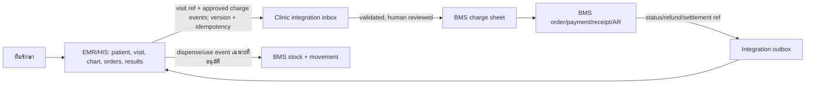
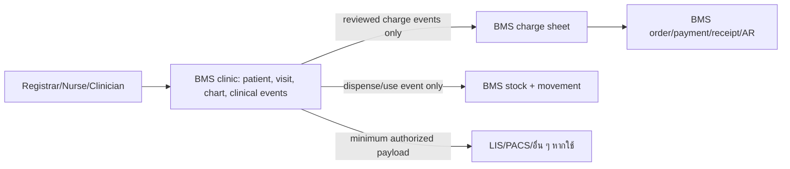

# Architecture decision: เจ้าของเวชระเบียนคลินิก

สถานะ: **Pending — ยังไม่เลือกทางใด** (26 พฤศจิกายน 2026). เจ้าของคลินิกยังไม่ทราบ/ยังไม่ยืนยันว่ามี EMR/HIS เดิมหรือไม่. เอกสารนี้กำหนด boundary ที่ต้องใช้ตัดสิน ไม่ใช่การอนุมัติเปิด pilot หรือเชื่อมระบบจริง. ข้อมูลสุขภาพใน technical pilot ยังคงอยู่หลัง flag ที่ปิดค่าเริ่มต้น และใช้ข้อมูลสังเคราะห์เท่านั้น.

## คำถามที่ต้องตอบก่อนเลือก

| ผู้ยืนยัน | หลักฐานที่ต้องได้ | ผลต่อแบบระบบ |
| --- | --- | --- |
| เจ้าของคลินิก/เวชระเบียน | มี EMR/HIS เดิมหรือไม่, vendor/contract/API, ระบบใดถือ patient ID, visit ID, signed record และเอกสาร | เลือก integration หรือขยาย BMS EMR; ห้ามมีสองแหล่งที่แก้ chart เดียวกัน |
| ผู้ประกอบวิชาชีพ | ประเภทบริการ, ฟอร์ม, สิทธิ์แต่ละวิชาชีพ, การลงนาม/แก้ไข, order/result/dispense, การตรวจใบอนุญาต | schema และ workflow ที่ต้องพัฒนา/รับรอง |
| เจ้าของข้อมูลส่วนบุคคล | ฐาน/ขอบเขตประมวลผล, การแบ่งข้อมูล, consent/ผู้แทน, retention/hold/export, backup/incident, vendor data handling | payload และวงจรข้อมูล; ไม่กำหนดระยะเก็บเอง |
| ฝ่ายบัญชี/ภาษี | ตารางบริการและราคาที่ประกาศ, VAT ต่อรายการ, payer/claim, เอกสารรับเงิน/คืน/ลูกหนี้ | approved charge contract และ payment/reconciliation |
| เจ้าของระบบ/ปฏิบัติการ | จำนวนสาขา, SLO, downtime, migration/restore, ระบบภาพ/แล็บ/ประกัน/อุปกรณ์ | topology, capacity, connector และ release gate |

## ทางเลือก A — EMR/HIS เดิมเป็นแหล่งข้อมูลจริง

ใช้เมื่อคลินิกมี EMR ที่เจ้าของคลินิกยืนยันให้ถือเวชระเบียน. EMR ถือ patient identity mapping, appointment/visit, clinical order, note, signature, result, dispense และเอกสารตามขอบเขตที่ตกลง. BMS ถือรายการบริการที่ฝ่ายบัญชีอนุมัติ, order, payment, refund, AR, receipt/tax และ stock เฉพาะเมื่อมี event การจ่าย/ใช้จริงที่ตกลงกัน. ต้องระบุเจ้าของนัดหมายและ patient master ให้ชัด; BMS pilot patient/encounter จะไม่กลายเป็น chart คู่ขนาน. ใน BMS เก็บเพียง external patient/visit reference แบบ opaque ที่ผูก tenant/branch, payer identity ที่จำเป็น, รายการค่าบริการและสถานะการเงิน. ไม่คัดลอกอาการ วินิจฉัย note หรือผลตรวจเข้าสู่ order/CRM/Inbox/AI/report การค้า.

**สัญญาข้อมูลขั้นต่ำที่ต้องออกแบบหลังเลือก A:** external system ID, tenant/branch, opaque patient/visit reference, event ID, schema version, occurred-at, authorized actor/source, approved service code/quantity/price snapshot/payer reference และการแก้/ยกเลิก. ไม่รับ clinical free text ใน charge event. การรับ event ต้อง authenticate source, map tenant ฝั่ง server, ตรวจ version/ลำดับ/duplicate, บันทึก inbox/outbox ใน transaction, retry และให้คนกระทบยอด mismatch. ไม่มีการสร้าง connector จากสมมติฐานว่า vendor รองรับ API.

## ทางเลือก B — BMS เป็นแหล่งเวชระเบียน

ใช้เมื่อไม่มี EMR เดิมหรือเจ้าของคลินิกเลือกย้าย โดยผ่านการตรวจรับด้านวิชาชีพ/ข้อมูลก่อน. `bms_clinic_*` เป็น patient/visit/chart source of truth แยกจาก CRM และ POS. ต่อจาก pilot ต้องเพิ่มประวัติสุขภาพแบบโครงสร้าง, งานพยาบาล, order/result/dispense/administration ที่แยก event, เอกสารลงนาม, audit, retention/hold และ workflow เฉพาะบริการที่ยืนยัน. BMS order/payment/stock ยังเป็น subsystems การค้า; charge sheet รับเฉพาะบริการที่ทำจริงผ่าน boundary ที่ตรวจราคา/ภาษี และ stock เปลี่ยนเมื่อจ่ายหรือใช้จริงพร้อม movement.

## Boundary ที่ใช้ทั้งสองทาง

1. Tenant/branch จาก server context; clinical read/write ต้องมี RBAC + active clinic role + care relationship. Admin, cashier, POS device token หรือ PIN ไม่ใช่สิทธิ์ chart. Emergency access มีเหตุผล/เวลา/audit และไม่ขยายไปไฟล์.
2. ข้อมูลสุขภาพ/ไฟล์อยู่หลัง route เฉพาะและ audit; generic file/CRM note/Inbox/marketing/AI tool/log/report การค้าไม่รับ clinical payload. AI ไม่มีสิทธิ์วินิจฉัย สั่งยา ลงนามหรือเปิด chart อัตโนมัติ.
3. Clinical order, dispense และ administration เป็นคนละเหตุการณ์. การสั่งยาอย่างเดียวไม่สร้าง charge หรือ movement. Billing และ stock ใช้ service เดิมผ่าน transaction ที่ตรวจยอด/ล็อต/rollback/retry.
4. เมื่อระบบรักษาและการเงินอยู่คนละ transaction ให้มี stable reference, outbox/inbox และ reconciliation โดยคน. Payment success ไม่แก้ไข note ที่ลงนาม; clinical correction ไม่ย้อนบิลเอง.
5. Integration/EMR expansion ต้องมี schema version, provenance, audit, idempotency, denial และ restore test ก่อนรับข้อมูลจริง. กระบวนการส่งออก/ลบ/hold ต้องได้ policy ที่เจ้าของข้อมูลอนุมัติ.

## เหตุผลที่ยังไม่เลือก

คำตอบเรื่อง EMR เดิมยังไม่ทราบ; การเลือก A อาจสร้าง connector ที่ใช้ไม่ได้จริง และการเลือก B อาจสร้าง chart คู่ขนานกับระบบที่คลินิกใช้อยู่. งานที่เดินต่อได้ปลอดภัยคือปิด release gates ของ pilot ด้วยข้อมูลสังเคราะห์, เก็บ feature inventory, ออกแบบ contract แบบมีเงื่อนไข และตรวจ data leakage. การขยาย clinical schema, import จริง, patient portal, dispensing และ connector ต้องรอเจ้าของเรื่องข้างต้น.

## เกณฑ์ปิด decision

บันทึกคำตอบ/ผู้อนุมัติ/วันที่/ระบบต้นทางเป็นลายลักษณ์อักษร; ระบุ owner ของ patient, appointment, visit, note, order, dispense, charge, payment, stock และไฟล์เป็นราย entity; ให้ clinical/privacy/accounting owners ตรวจ payload; ยืนยันข้อห้าม chart คู่ขนานและแผน migration/rollback. หลังเลือกแล้วอัปเดต [feature matrix](clinic-full-feature-matrix-th.md), [backlog](clinic-full-backlog-th.md), data-flow map และคู่มือก่อนลงมือ implementation ที่ขึ้นกับ decision.
