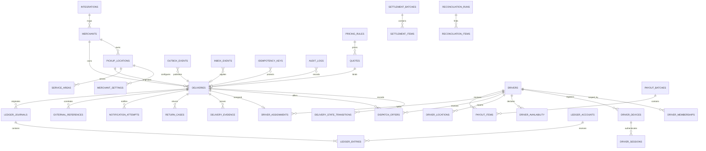

# ERD proposal

This is a logical design only; no migration exists. Names are provisional and all tenant/branch/order
links use verified server-side mappings. Each Evidence label applies to the whole row or bullet.

## Aggregate/table proposal

| Aggregate / tables | Key invariants | Evidence |
| --- | --- | --- |
| Integration/merchant | `integrations`, `merchants`, `pickup_locations`, `external_references`; unique active BMS tenant/branch mapping; deactivate rather than repurpose refs | `PROPOSED` |
| Merchant policy | `merchant_settings`, `service_areas`, `pricing_rules`, `subsidy_rules`; effective-dated immutable activated versions | `PROPOSED` |
| Quote | `quotes`, `quote_components`; THB satang, route/pricing/eligibility versions, expiry, one immutable bind outcome | `PROPOSED` |
| Delivery | `deliveries`, `delivery_state_transitions`, `recipient_snapshots`; one active BMS order fulfillment ref, expected aggregate version, append-only transitions | `PROPOSED` |
| Driver identity | `drivers`, `driver_memberships`, `driver_documents`, `vehicles`, `driver_devices`, `driver_sessions`; separate from BMS principals, expiry/suspension history | `PROPOSED` |
| Availability/location | `driver_availability`, partitioned `driver_locations`; server receive time, sequence and retention partition key | `PROPOSED` |
| Dispatch | `dispatch_policy_versions`, `dispatch_attempts`, `dispatch_offers`, `driver_assignments`; one accepted assignment/delivery, one active offer decision per driver/delivery/version | `PROPOSED` |
| Evidence/return/dispute | `delivery_evidence`, `return_cases`, `disputes`; private object ref, content hash, review/hold state, no public URL | `PROPOSED` |
| Notification | `notification_endpoints`, `notification_attempts`; token encrypted/revocable, send idempotency, provider result not business truth | `PROPOSED` |
| Finance | `ledger_accounts`, `ledger_journals`, `ledger_entries`, `commission_records`, `driver_earnings`, `cod_collections`, `settlement_batches/items`, `payout_batches/items`, `adjustments`; balanced immutable posted journals and unique allocations | `PROPOSED` |
| Reliability | `idempotency_keys`, `outbox_events`, `inbox_events`, `dead_letters`, `reconciliation_runs/items`; body hash, lease/retry, replay/audit metadata | `PROPOSED` |
| Governance | `audit_logs`, `legal_holds`, `retention_runs`, `admin_settings`; append-only sensitive audit and effective-dated switches | `PROPOSED` |

## Delivery aggregate minimum fields

- `PROPOSED`: internal id; integration, merchant, pickup-location ids; opaque BMS tenant/branch/order/
  customer refs; BMS order/version observed; quote id; exact fee components; currency; state/version;
  assignment id; readiness/handoff refs; created/updated/terminal timestamps.
- `PROPOSED`: recipient snapshot is a separately encrypted/purgeable record so finance/audit history
  can survive lawful deletion without retaining address/contact.
- `PROPOSED`: state transition records include from/to, version, actor/principal, reason code, request/
  correlation/idempotency ids and occurred/recorded timestamps.
- `PROPOSED`: no catalog, stock, merchandise price, BMS payment, BMS refund or tax-document ledger is
  duplicated.

## Database constraints to prove

- `PROPOSED`: unique active `(integration_id, bms_order_ref, fulfillment_kind)` and immutable bound
  quote reference.
- `PROPOSED`: unique accepted assignment per delivery and unique active driver assignment according
  to approved capacity policy; acceptance uses a locked/versioned transaction.
- `PROPOSED`: check `amount_satang >= 0` where appropriate, currency `THB`, exact balanced posted
  journal and immutable posted entries.
- `PROPOSED`: unique inbox producer/message id, unique outbox message id and unique idempotency
  principal/operation/key with request hash.
- `PROPOSED`: UTC timestamps; reporting timezone/cutoff and policy/rule versions are explicit
  snapshots.
- `PROPOSED`: large lists use composite cursor indexes; location uses PostGIS index plus retention
  partitions. Raw location is never the only assignment lock.

## Tenancy decision

- `PROPOSED`: all operational rows carry internal merchant/integration scope even if a platform pool
  is later approved; object authorization never depends on a nullable tenant column alone.
- `UNRESOLVED`: decide between PostgreSQL RLS plus application predicates or application-only
  isolation. Safe recommendation is defense-in-depth RLS with dedicated migration/negative tests,
  but only after the driver-pool/global-operations access model is approved.

**STOP — Awaiting approval.**
