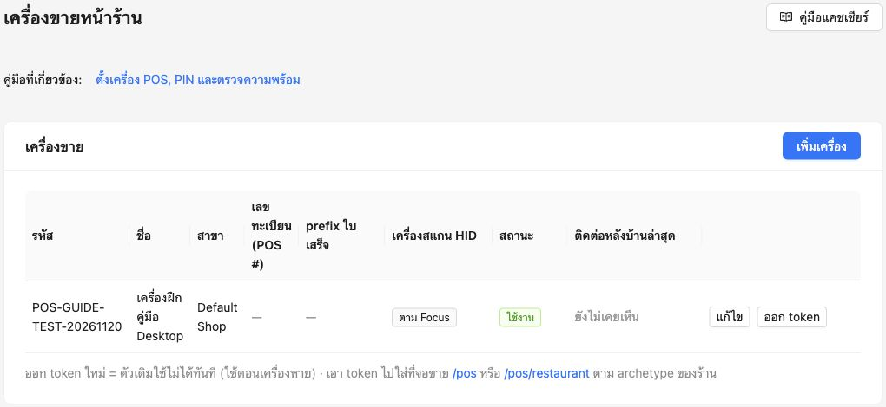
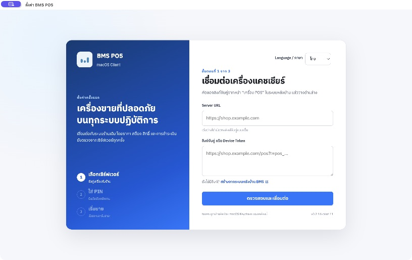

## ใช้งาน BMS POS Desktop: ติดตั้ง จับคู่ และเปิดกะ

**ผู้ทำ:** ผู้ดูแลร้านที่มีสิทธิ์จัดการเครื่อง POS เตรียมเครื่องและลิงก์จับคู่; แคชเชียร์ที่มี `pos.shift.open` ใช้ PIN ของตนเปิดกะ ทำขั้นตอนนี้ในร้านและสาขาทดสอบก่อนรับเงินจริง

**แยกสามหน้าจอ:** Admin (`/admin/*`) ใช้ตั้งสาขา สินค้า ผู้ใช้ สิทธิ์ และเครื่องขายผ่านบัญชีผู้ดูแล; Web POS (`/pos`) คือหน้าขายเต็มในเบราว์เซอร์; BMS POS Desktop คือแอปที่ติดตั้งบน Windows, Linux หรือ macOS ซึ่งเปิด `/pos/app` จากเซิร์ฟเวอร์ที่จับคู่ แล้วส่งงานบางประเภทไปหน้าขายเต็มหรือ `/pos/restaurant` ภายในแอปตามประเภทร้าน ทั้งสามทางใช้ข้อมูลและกฎจากเซิร์ฟเวอร์เดียวกัน แอป Desktop ต้องออนไลน์ และโหมด Emergency Offline มีบนมือถือเท่านั้น

1. ผู้ดูแลดาวน์โหลดตัวติดตั้ง POS ที่เผยแพร่สำหรับระบบปฏิบัติการของเครื่องจากแหล่งของ BMS แล้วติดตั้ง/เปิด **BMS POS**; ตรวจรุ่นและเซิร์ฟเวอร์กับผู้ดูแลก่อนเปิดร้าน หน้าแรกมีช่อง **Language / ภาษา** ให้เลือก **ไทย** หรือ **English** การเลือกภาษาตอนนี้ไม่ใช่การตั้งค่าภาษาใบเสร็จ
2. ใน Admin เปิด **เครื่องขาย + PIN** (`/admin/pos-devices`) กด **เพิ่มเครื่อง** แล้วกรอก **รหัสเครื่อง**, **ชื่อเครื่อง**, **สาขา**; บันทึกแล้วกด **ออก token** ที่แถวเครื่องเพื่อรับลิงก์จับคู่ บนแอป Desktop กรอก **Server URL** เช่น `https://shop.example.com` และวาง **ลิงก์จับคู่ หรือ Device Token** ในช่องตามชื่อ กด **ตรวจสอบและเชื่อมต่อ** หากวางลิงก์เต็ม ช่อง Server URL เว้นว่างได้ ห้ามใส่ลิงก์จริงในคู่มือ ภาพ หรือข้อความที่ส่งต่อ

**ภาพที่ 1 — รายการเครื่องขายทดสอบใน Admin (20 พ.ย. 2026):** สังเกต **เพิ่มเครื่อง**, รหัสเครื่อง, ชื่อ, สาขา, สถานะ และ **ออก token** แถวนี้เป็นเครื่องฝึกที่สร้างในร้านทดสอบ ไม่มี token ในภาพ ต้นทาง: `/admin/pos-devices` (ต้องเข้าสู่ระบบและมีสิทธิ์จัดการเครื่อง) สถานะ: ตรวจ UI และสร้างเครื่องสำเร็จ ไม่ใช่หลักฐานว่าจับคู่หรือขายสำเร็จ

**ภาพที่ 2 — หน้าจับคู่ BMS POS Desktop บน macOS (20 พ.ย. 2026):** สังเกต **Language / ภาษา**, **Server URL**, **ลิงก์จับคู่ หรือ Device Token**, และ **ตรวจสอบและเชื่อมต่อ** ภาพถ่ายจากแอปที่ติดตั้งจริง ขณะอยู่หน้าตั้งค่า จึงยืนยันเฉพาะ UI ไม่ยืนยันว่าจับคู่หรือขายสำเร็จ ต้นทาง: `apps/desktop/renderer/setup.html` (หน้าภายในแอป ไม่มี URL เว็บ)

3. ตรวจชื่อเครื่องและสาขาที่แอปแสดงหลังเชื่อมต่อ หากไม่ตรง ให้หยุดก่อนขายและให้ผู้ดูแลแก้เครื่องหรือสาขา อย่าแก้ด้วยการใช้เครื่องของร้านอื่น แอปเก็บการจับคู่แบบเข้ารหัสในพื้นที่ผู้ใช้ของระบบปฏิบัติการ; การเปิดแอปครั้งถัดไปควรกลับเข้าเครื่องเดิมโดยไม่ต้องวาง token ซ้ำ การออก token ใหม่ให้เครื่องเดิมทำให้ token เก่าใช้ไม่ได้
4. ที่หน้าพนักงาน เลือกชื่อของตน กรอก **PIN พนักงาน 4–8 หลัก** แล้วกด **เข้าสู่ระบบ** ถ้าไม่ผ่านให้ตรวจชื่อ, PIN, สิทธิ์ และการล็อกชั่วคราว; HTTP 403 ให้ผู้ดูแลตรวจสิทธิ์ ไม่ใช่ลบการจับคู่
5. หากยังไม่มีกะ แอปแสดง **เปิดกะเงินสด**: กรอก **เงินสดตั้งต้น** ตามเงินทอนในลิ้นชัก เช่น `500.00` แล้วกด **เปิดกะและเริ่มขาย** ตรวจว่ากะเปิดและสาขาที่หัวหน้าขายตรงกับเครื่อง ผู้เปลี่ยนคนใช้ **ล็อก / เปลี่ยนพนักงาน**; ผู้ปิดกะต้องมี `pos.shift.close` และปิดจากเมนู **กะ** หลังตรวจบิลค้าง
6. เมนูข้างแอปมี **ขาย**, **คืน**, **รับของ**, **มัดจำ**, **กะ**, **ตั้งค่า** และเมนูเฉพาะร้านเมื่อเปิดใช้ สิ่งที่ยังไม่ย้ายเข้าหน้าขายแบบย่อจะแสดงหน้าขายเต็มภายในแอป กด `Command/Ctrl+R` เพื่อรีเฟรชข้อมูลของหน้างาน; `Command/Ctrl+Shift+R` ใช้โหลดแอปใหม่ทั้งหน้าเมื่อหน้าค้าง อย่ารีโหลดระหว่างผลรับเงินที่ยังไม่ชัด ให้ตรวจบิลเดิมก่อน

**เมื่อเชื่อมต่อไม่ได้:** หากหน้าเริ่มต้นขึ้น **ลองใหม่** ให้ตรวจอินเทอร์เน็ตและเซิร์ฟเวอร์แล้วกดปุ่มนี้ก่อน เพราะใช้ข้อมูลจับคู่เดิม หากขึ้นว่าอ่านข้อมูลจับคู่เดิมไม่ได้ ให้ปลดล็อก Keychain/ที่เก็บข้อมูลของระบบและใช้บัญชี OS เดิมแล้วกด **ลองใหม่**; **เปลี่ยนเซิร์ฟเวอร์** เป็นการลบการจับคู่เดิมโดยตั้งใจ ให้ทำเมื่อผู้ดูแลยืนยันว่าเปลี่ยนปลายทางจริงเท่านั้น เก็บข้อความผิดพลาดและรุ่นแอปส่งผู้ดูแล โดยไม่ส่ง token หรือ PIN

### ภาพและหน้าจอที่ตรวจสอบ

| หมายเลขภาพ | หน้าจอ | URL/path ที่ปลอดภัย | วันที่จับภาพ | บทบาท/สิทธิ์ | สถานะ |
| --- | --- | --- | --- | --- | --- |
| ภาพที่ 1 | Admin รายการเครื่องขายทดสอบ | `/admin/pos-devices` (ต้องเข้าสู่ระบบ) | 20 พ.ย. 2026 | ผู้ดูแลจัดการเครื่อง | ตรวจ UI และสร้างเครื่องสำเร็จ; ยังไม่จับคู่ |
| ภาพที่ 2 | Desktop ตั้งค่า/จับคู่ (macOS) | `apps/desktop/renderer/setup.html` | 20 พ.ย. 2026 | ก่อนเข้าสู่ระบบ; ผู้ดูแลเตรียมลิงก์ | ตรวจ UI เท่านั้น |
| — | PIN, เปิดกะ, ขาย, ใบเสร็จ, ปิดกะ | `/pos/app` (ต้องเข้าสู่ระบบ/จับคู่) | — | พนักงานและสิทธิ์ตามงาน | ตรวจจากโค้ด; ยังไม่ทดลองรายการจริง |

